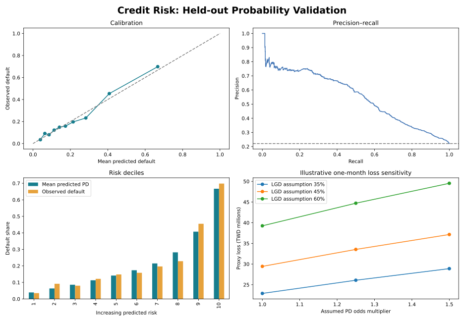

# Credit Risk Modelling and Validation in Python

**How well can financial history estimate next-month default probabilities, and how stable are the resulting scores and illustrative loss calculations?**

Independent banking portfolio research using public historical data. Created with AI assistance; not an employer implementation or a claim of production deployment.



## Measured result

Held-out ROC AUC **0.780**, average precision **0.554**, and Brier score **0.1345** versus **0.1723** for the training-prior baseline.

Read [findings and recommendations](reports/FINDINGS.md), [full metrics](reports/metrics.json) and the supporting CSV reports. Figures are generated by running the committed Python analysis.

## What makes this more than a classifier demo

- Financial-history feature engineering with strict input checks.
- Identical financial profiles kept within one split to reduce duplicate-profile leakage.
- Four disjoint partitions: model fitting, probability calibration, model selection and final evaluation.
- Logistic regression challenger and histogram gradient boosting, selected by validation Brier score.
- Independent Platt-style sigmoid calibration using only the calibration partition.
- Calibration curves, ROC AUC, average precision, risk deciles, bootstrap uncertainty and a constant-prior baseline.
- Custom good/bad-odds score scaling with an explicit 20-points-to-double-the-odds convention.
- Aggregate subgroup diagnostics using fields excluded from model fitting.
- Scenario grid for next-month PD odds, assumed LGD and a clearly labelled bill-balance exposure proxy.
- Validation-set permutation importance, transparent logistic challenger coefficients and local batch scoring.

## Reproduce

Python 3.12 was used. Run from this repository's root:

```bash
python -m venv .venv
# macOS/Linux
source .venv/bin/activate
# Windows PowerShell: .venv\Scripts\Activate.ps1
python -m pip install -r requirements.txt
python download_data.py
python run.py
python -m unittest discover -s tests -v
```

The download is approximately 5.5 MB. Raw input, generated estimators and row-level predictions remain in ignored `data/` and `artifacts/` folders. `reports/` contains published aggregate results, figures and the methodological audit. Dependency versions are pinned.

## Batch research scoring

After training locally:

```bash
python score_profiles.py path/to/financial_profiles.csv
```

The scorer uses the locally generated `artifacts/model.joblib`, preserves preprocessing and calibration, and requires the input schema described in [MODEL_CARD.md](docs/MODEL_CARD.md). It writes research outputs; it does not approve/decline credit, block transactions, or contact customers. Use only estimator files you generated locally; joblib files are executable serialised Python objects.

## Repository guide

| Path | Purpose |
| --- | --- |
| `run.py` | End-to-end experiment and report generation |
| `banklab/` | Reusable statistical helpers and financial feature/score functions |
| `download_data.py` | Public dataset acquisition and checksum validation |
| `reports/` | Measured aggregate results and charts |
| `tests/` | 7 meaningful feature/policy and completed-run checks |
| `docs/` | Data provenance, model card and experiment protocol |
| `.github/workflows/verify.yml` | Fresh download, training and tests in CI |

## Interpretation limits

The source is one historical Taiwanese credit-card cohort, with no suitable observation-date field for an out-of-time split. Random profile-group holdouts cannot establish performance on future periods or UK borrowers. Score values are a custom research scale, not FICO or a lender's validated scorecard. Sensitivity values are one-month illustrations, not IFRS 9 ECL, regulatory capital or a macroeconomic forecast. Excluding demographics does not establish fairness.

## Sources and licence

Yeh, I. (2009). Default of Credit Card Clients [Dataset]. UCI Machine Learning Repository. https://doi.org/10.24432/C55S3H.

See [DATA_SOURCE.md](docs/DATA_SOURCE.md) for source URLs, original terms, provenance and changes. Code is [MIT licensed](LICENSE); data rights are separate.
